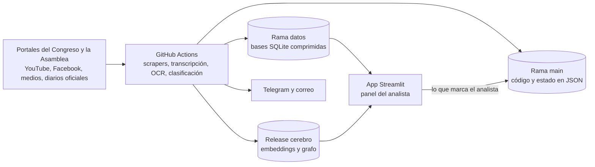

# Radar Legislativo (Vali Intelligence)

Herramienta interna de una consultora de asuntos públicos. Sigue todos los días
lo que pasa en el Congreso del Perú y en la Asamblea Nacional del Ecuador, lo
cruza con normas y noticias, y le dice al analista qué le interesa a cada
cliente.

## Objetivos

1. **No perder nada relevante.** Reunir en un solo lugar los proyectos de ley,
   las agendas, las sesiones, las votaciones, las normas publicadas y las
   noticias de los dos países.
2. **Avisar a tiempo.** Detectar lo que le importa a cada cliente y avisarlo
   por Telegram y por correo el mismo día, incluso mientras una sesión sigue
   en vivo.
3. **Ahorrar lectura.** Transcribir y resumir las sesiones para que el analista
   no tenga que ver horas de video.
4. **Funcionar sin servidor propio.** Todo corre gratis en GitHub Actions y en
   Streamlit Community Cloud.

## Qué hace

| Función | Detalle |
|---|---|
| Proyectos de ley | Baja todos los proyectos del Congreso (Perú) y de la Asamblea (Ecuador), con su estado, comisiones, autores y documentos. Les asigna un tema. |
| Agenda | Sesiones de comisiones y del Pleno de los dos países, y qué proyectos se tratan en cada una. |
| Sesiones en vivo | Detecta cuándo empieza una sesión en YouTube o Facebook, la transcribe con Whisper, la resume y avisa si se menciona algo de interés. |
| Votaciones | Votos nominales del Pleno. Los lee del PDF oficial y usa OCR cuando el PDF es un escaneo. |
| Noticias y normas | Lee unas 120 fuentes (medios, entidades públicas, El Peruano, Registro Oficial), las clasifica por tema y junta las que cuentan el mismo hecho. |
| Televisión | Revisa los subtítulos de programas de TV y entrevistas para encontrar menciones de autoridades y temas seguidos. |
| Interés por cliente | Un modelo de lenguaje (Gemini) lee cada novedad junto al perfil del cliente y decide si le interesa y por qué. |
| Alertas | Telegram en el momento, un resumen diario y un correo a las 9:00 y a las 14:00 (hora de Lima) solo si hay novedades. |
| Búsqueda | Búsqueda por significado sobre todo el contenido, con embeddings locales, y un grafo de conocimiento. |
| Panel web | Una sola página donde el analista revisa su bandeja, sigue proyectos, lee transcripciones y redacta alertas. |

## Cómo fluye el dato



1. Los **workflows** de `.github/workflows/` corren los scrapers según un
   horario y escriben en dos bases SQLite, `proyectos.db` (Perú, y lo común a
   los dos países) y `proyectos_ec.db` (Ecuador).
2. `scripts/publicar_db.sh` sube esas bases comprimidas a la rama **`datos`**.
   Esa rama tiene un solo commit que se reemplaza en cada publicación, así el
   repositorio no crece. `proyectos.db` se publica en partes, una por cada
   grupo de workflows que la escribe (`core/partes.py`).
3. La **app** (`app.py`) baja las bases de `datos` al arrancar y vuelve a
   revisar cada 30 minutos.
4. Lo que el analista marca en la web (seguir un proyecto, descartar una
   noticia, guardar un borrador) se guarda como un commit en `main` por la API
   de GitHub (`core/store.py`). Por eso el historial tiene muchos commits
   automáticos.

## Mapa del repositorio

| Carpeta | Qué contiene |
|---|---|
| `app.py` | Punto de entrada. Carga los secretos, baja las bases, exige el login y monta la página. |
| `pages/` | La única página, `0_Hoy.py`. Monta la interfaz y pasa las acciones del navegador al servidor. |
| `front/` | Interfaz propia. Los `.js` y el `.css` corren en el navegador. `vistas.py` prepara los datos de cada sección y atiende las acciones. |
| `core/` | Piezas comunes: conexión a SQLite, bases en partes, guardado de JSON en GitHub, cliente de Gemini, utilidades de texto, hora y HTTP. |
| `scraper/` | Proyectos de ley del Perú desde la API del portal del Congreso. Define el esquema de `proyectos.db` y los temas. |
| `scraper_ec/` | Proyectos de ley del Ecuador. Define el esquema de `proyectos_ec.db`. |
| `sesiones/` | Agenda de las comisiones del Congreso del Perú. |
| `pleno/` | Agenda del Pleno del Perú, leída de los PDF de cada cámara. |
| `agenda_ec/` | Agenda de la Asamblea del Ecuador desde su calendario público. |
| `mesas_tecnicas/` | Mesas de trabajo y eventos del Congreso del Perú. |
| `votaciones/` | Votos nominales del Pleno del Perú, por texto del PDF o por OCR. |
| `congreso_live/` | Sesiones en vivo: detección, transcripción, resumen, oradores y avisos. |
| `noticias/` | Fuentes, scraper de noticias y normas, temas, monitor de TV y juez de "mismo hecho". |
| `consultas/` | Consultas que usa la interfaz. También tiene los scrapers de cargos, integrantes, votos de comisiones y posturas. |
| `clasificador/` | Modelo que asigna tema a los proyectos de ley (TF-IDF y regresión logística). |
| `models/` | El modelo entrenado del clasificador. |
| `cerebro/` | Búsqueda por significado (embeddings y sqlite-vec) y grafo de conocimiento. |
| `clientes/` | Fichas de clientes **cifradas**, el código que las cifra y la configuración por cliente. |
| `alerts/` | Correo diario, juez de interés por cliente, resumen del día, proyectos seguidos, bandeja y redacción de alertas. |
| `auth/` | Registro de usuarios que reciben el correo. El login está en `app.py`. |
| `sistema/` | Registro de cada corrida y aviso cuando un workflow falla o deja de correr. |
| `scripts/` | Publicar y bajar las bases, proxy para YouTube y dos vigías puntuales. |
| `data/` | Estado en JSON que escriben los workflows y la app, y las fotos de los asambleístas. Las bases no van aquí. |
| `docs/` | `INSTALAR.md`, la guía para montar todo desde cero. |

Los tests están junto al código que prueban, en archivos `test_*.py`.

## Automatizaciones

Todo lo programado vive en `.github/workflows/`. Los principales:

| Workflow | Cuándo corre | Qué hace |
|---|---|---|
| `refrescar-pe.yml` | Cada hora, de 8:00 a 22:00 (Lima) | El recorrido principal: proyectos del Perú, agendas, noticias de los dos países, normas, votaciones y el correo. |
| `enriquecer-ec.yml` | 4 veces al día | Proyectos, documentos y agenda del Ecuador. |
| `vigilar-congreso.yml` | Cada 10 minutos en horario parlamentario | Detecta sesiones en vivo, las transcribe y avisa. |
| `backfill-auto.yml`, `backfill-vod.yml`, `videos-pedidos.yml` | Cada 6 horas o a pedido | Recuperan y transcriben sesiones que no se captaron en vivo. |
| `oradores.yml` | Cada 3 horas | Identifica quién habla en cada transcripción. |
| `posturas.yml` | Cada 3 horas | Lee las sesiones y anota la postura de cada parlamentario. |
| `tv-monitor.yml`, `tv-en-vivo.yml` | Varias veces al día | Monitor de televisión y entrevistas. |
| `cerebro.yml` | Al terminar los anteriores | Embeddings, juez de interés por cliente, resumen del día y grafo. |
| `votaciones-ocr-bicameral.yml` | Diario | OCR de las votaciones escaneadas. |
| `entrenar-ml.yml` | Domingos | Reentrena el clasificador de temas. |
| `salud.yml` | Cada hora | Avisa si algún workflow falló o no corrió. |
| `tests.yml` | En cada push y pull request con código | Corre `pytest`. |

Los demás son manuales: `enviar-aviso.yml`, `probar-avisos.yml`,
`buzon-clientes.yml`, `rotar-clave-clientes.yml`, `entrenar-mismo-hecho.yml`
y `votaciones-ocr.yml`.

Dos servicios externos disparan workflows porque el horario propio de GitHub
se atrasa. Están descritos en `docs/INSTALAR.md`, sección 6.

## Correrlo en local

Hace falta Python 3.13. En Windows los comandos van en Git Bash.

```bash
git clone https://github.com/nicosil02/Base_legislativa.git
cd Base_legislativa
python -m venv .venv
source .venv/Scripts/activate            # Linux y Mac: source .venv/bin/activate
pip install -r requirements.txt -c constraints.txt

cp .env.example .env                     # y poner VALI_SIN_LOGIN=1
python -m streamlit run app.py
```

La app baja sola las bases de la rama `datos` en el primer arranque. Sin
`VALI_SIN_LOGIN=1` en el `.env` no abre, porque exige el login de Google.

Sin la clave de clientes (`CLIENTES_CLAVE`) todo funciona, pero sin las
secciones que dependen de las fichas de clientes ni la búsqueda por
significado.

La guía completa, con los secretos y los servicios externos, está en
[`docs/INSTALAR.md`](docs/INSTALAR.md).

### Tests

```bash
pip install pytest pyyaml faster-whisper -c constraints.txt
python -m pytest
```

### Comandos sueltos

Cada módulo se puede correr por separado. Algunos ejemplos:

```bash
python -m scraper.cli update                    # proyectos de ley del Perú
python -m scraper.cli show 14515                # detalle e historial de un proyecto
python -m noticias.cli sync                     # noticias y normas
python -m congreso_live.cli check               # ¿hay una sesión en vivo ahora?
python -m clientes.nuevo crear acme --nombre "Acme" --paises PE,EC
```

## Seguridad y datos

El repositorio es público. Estas son las reglas que lo hacen posible.

- **Login.** La app solo abre con una cuenta de Google de los dominios
  autorizados (`ALLOWED_DOMAINS` en `app.py`).
- **Datos de clientes cifrados.** Los perfiles, las matrices, el historial de
  alertas y lo que marca el analista van en git solo como `*.cifrado`. La clave
  es el secreto `CLIENTES_CLAVE`. El código está en `clientes/privado.py` y
  `core/store.py`. Sin la clave nunca se escribe nada en claro. Los adjuntos
  del release `cerebro` llevan relevancia por cliente y también van cifrados
  (`scripts/cerebro_release.sh`).
- **Secretos.** Ninguno está en el repositorio. Viven en los Secrets de GitHub
  Actions y de Streamlit Cloud. Sus nombres están en `docs/INSTALAR.md`.
- **Las bases no van en `main`.** Van en la rama `datos`. No hay que commitear
  ningún `*.db` ni `*.db.gz`.
- **Los avisos no se escriben en los logs.** Los logs de GitHub Actions de un
  repositorio público también son públicos.

## Convenciones

- **Idioma.** El código y los comentarios están en español. Algunas carpetas
  antiguas tienen nombre en inglés (`scraper`, `alerts`, `core`).
- **Comentarios con fecha.** Cuando un comentario cita una fecha, explica un
  error real que ocurrió ese día y por qué el código quedó así.
- **Comentarios `ponytail:`.** Marcan una simplificación hecha a propósito e
  indican cuál es su límite y cuándo convendría cambiarla.
- **Versiones fijas.** `requirements.txt` tiene lo que usa la app.
  `constraints.txt` fija la versión de todo lo que instalan los workflows. Un
  test falla si un workflow instala algo sin usarlo.
- **Historial.** La mayoría de los commits de `main` son datos automáticos.
  Para ver solo los cambios de código:

  ```bash
  git log --oneline -- '*.py' '*.js' '*.css' '*.yml' '*.sh' '*.md'
  ```

## Detalles del Congreso del Perú

El portal oficial de proyectos de ley consume una API REST en
`https://api.congreso.gob.pe/spley-portal-service`. El scraper usa esa misma
API (`scraper/client.py`).

- **Listado.** `POST /proyecto-ley/lista-con-filtro` devuelve todos los
  proyectos de un período.
- **Detalle.** `GET /expediente/{período}/{número}`. El portal cifra esos dos
  parámetros con AES-128-ECB y el scraper hace lo mismo.
- **Sincronización incremental.** Solo se pide el detalle de los proyectos
  nuevos o de los que cambiaron de estado.

El Congreso pasó de una cámara a dos (Senado y Cámara de Diputados) el 27 de
julio de 2026. El sistema sincroniza solo el período vigente.

| Período | Congreso | Estado |
|---|---|---|
| 2021-2026 | Unicameral | Histórico |
| 2026-2031 | Bicameral | Vigente |
